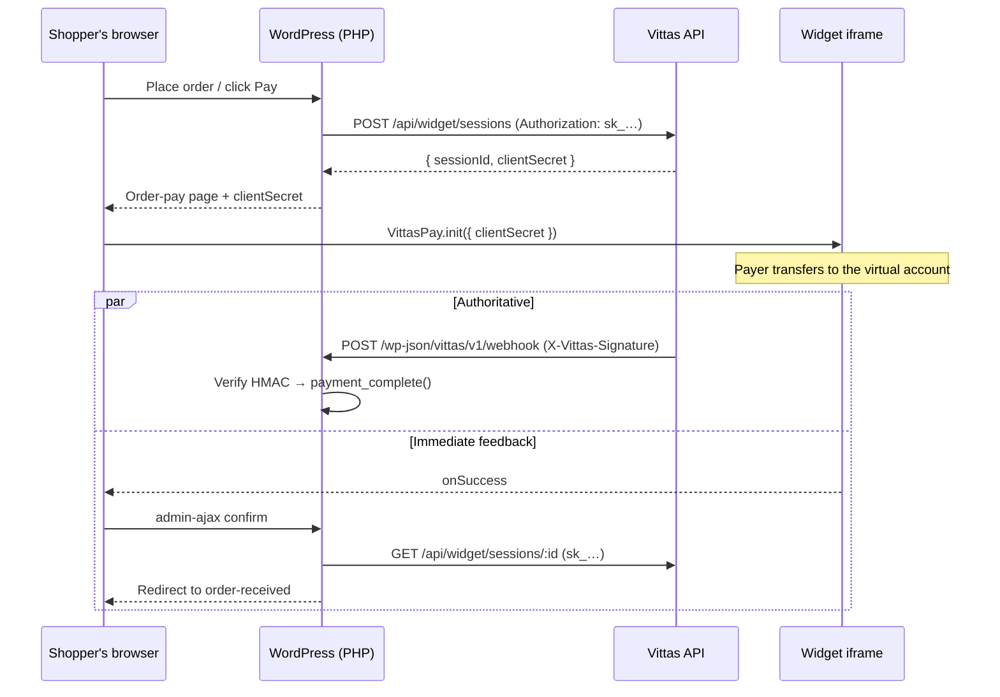

# Vittas Payments for WordPress

Official WordPress integration for the [Vittas payment widget](../vittas-core-payment-widget).

- **WooCommerce gateway** — instant bank transfer checkout on classic *and* block checkout.
- **`[vittas_pay]` shortcode + block** — a pay button for any WordPress page, no WooCommerce required.
- **Signed webhook receiver** — orders settle from a verified server-to-server callback.

```
vittas-core-wordpress/
├── vittas-payments/        The plugin (this is what merchants install)
└── example/                docker-compose demo store
```

## How it fits together

The widget's security model splits work between a server that holds the secret
key and a browser that only ever sees a session-scoped client secret.
WordPress has a real PHP backend, so it maps onto that split directly — no
proxy service, and no change to the widget or the Vittas API.



Those two paths race deliberately, and both are idempotent. The webhook is what
guarantees settlement — a shopper who closes the tab is still settled by it.
The browser path exists so the shopper sees a confirmed order immediately, and
so a site whose webhook endpoint is unreachable (local dev, firewalled host)
still works.

**The browser is never trusted.** `onSuccess` fires in the payer's page and only
triggers a server-side re-read of the session with the secret key; nothing about
the outcome is taken from the request body.

## Install

Download `vittas-payments-<version>.zip` from
[Releases](https://github.com/Vittas-Inc/vittas-core-wordpress/releases) and
upload it via Plugins → Add New → Upload Plugin.

Once installed, the plugin checks this repository's releases and shows
**Update available** on the Plugins screen like any WordPress.org plugin —
one click to update. That is the point of shipping it this way: a payment
plugin whose security fixes never reach merchants is worse than no plugin.

> Updates are served from the release **asset** (the built zip), not the source
> tarball, so the archive unpacks to `vittas-payments/` and excludes the demo
> store and CI config.

## Releasing

The plugin header version is the source of truth. `readme.txt`'s `Stable tag`
and the git tag must agree with it — both `bin/build-zip.sh` and the release
workflow refuse to build otherwise, because a mismatch makes WordPress offer
the same update forever.

```bash
# 1. bump Version: in vittas-payments/vittas-payments.php and Stable tag: in readme.txt
# 2. verify the archive builds and is well-formed
bash bin/build-zip.sh
# 3. tag — CI builds and publishes the release
git tag v0.1.1 && git push origin v0.1.1
```

Then, under **Vittas Payments** in the admin menu:

1. Choose Test or Live and paste the matching secret key.
2. Copy the **Allowed origin** shown there into your Vittas widget settings.
3. Copy the **Webhook URL** shown there into Vittas → Developers → Webhooks, and
   paste the signing secret it returns back into the plugin.
4. Hit **Test connection** to confirm the key is accepted.

For WooCommerce, enable **Bank Transfer (Vittas)** under
WooCommerce → Settings → Payments.

## Shortcode

```
[vittas_pay amount="2500" label="Donate ₦2,500" reference="DONATION"]
[vittas_pay amount="0" min="500" max="500000" label="Donate"]
```

| Attribute | Default | Notes |
|---|---|---|
| `amount` | `0` | Naira, not kobo. `0` lets the payer choose. |
| `currency` | `NGN` | |
| `label` | `Pay now` | Button text. |
| `description` | — | Copy above the button. |
| `reference` | `WP` | Prefix for the generated reference. |
| `redirect` | — | URL to send the payer to after a confirmed payment. |
| `min` / `max` | `100` / — | Bounds for open amounts, in naira. |

The amount is **server-signed**, not read from the request: the shortcode emits
an HMAC token describing the charge and the AJAX endpoint charges what the token
says. Without that, any visitor could pay ₦1 for a ₦50,000 item, since the
session-creation endpoint has to be publicly callable.

## Hooks

| Hook | Fires |
|---|---|
| `vittas_webhook_received` ( `$event`, `$data` ) | Every verified webhook, before order handling. Use this to fulfil on non-WooCommerce sites. |
| `vittas_shortcode_payment` ( `$state` ) | A shortcode payment confirmed server-side. |
| `vittas_order_paid` ( `$order`, `$data` ) | A WooCommerce order marked paid. |
| `vittas_order_mismatch` ( `$order`, `$data` ) | A wrong-amount payment put the order on hold. |
| `vittas_order_reference` ( `$reference`, `$order` ) — filter | Change the reference sent to Vittas. |
| `vittas_order_metadata` ( `$metadata`, `$order` ) — filter | Change the metadata echoed in webhooks. |
| `vittas_session_rate_limit` ( `$limit` ) — filter | Shortcode sessions allowed per IP per minute (default 5, `0` disables). |

## Credentials

Only the **secret key** is configured. The public key has no role: WordPress
creates every session server-to-server, and the browser only receives the
session-scoped client secret that comes back.

Stored keys are never written into the settings page HTML — the field shows a
fingerprint and submits empty, where empty means "keep what you have".

## Notes and limits

- **NGN only.** The gateway hides itself on stores using any other currency.
- **No programmatic refunds.** The bank transfer rail has no refund API yet, so
  refund support is deliberately not declared rather than offering a button that
  always fails.
- **Underpayment stops.** A `successful` session that does not cover the order
  total puts the order on hold instead of completing it.
- **Live mode requires production keys.** `sk_test_` keys reach the sandbox host
  and `sk_live_` keys production — the plugin picks the host from the mode, the
  same way the widget picks its API host from the `cs_` prefix.
- **Cross-site safety.** One Vittas merchant account can serve several sites, so
  every session carries the originating `site_url` and the webhook ignores
  payloads from anywhere else.

## Demo

See [`example/`](example/) — `docker compose up -d && docker compose run --rm seed`
gives a seeded store, a donation page and an optional Cloudflare tunnel for
webhook testing.
